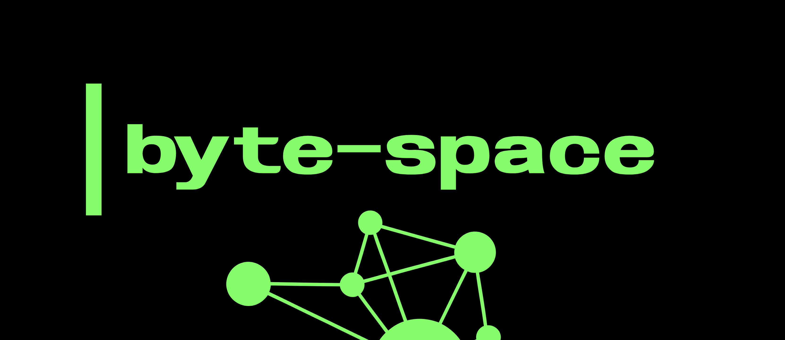

<div align="center">



<br>

# byte-space

**Simulated Unix Machines and a Hand-Written Filesystem**

[](https://go.dev)
[](https://opensource.org/licenses/MIT)

[Demo](#demo) • [Installation](#installation) • [Quick Start](#quick-start) • [How It Works](#how-it-works) • [BS-EXTFS](#bs-extfs) • [Features](#features)

---

</div>

byte-space simulates Unix machines that you connect to from a terminal. A server process
holds any number of virtual computers, and you open a session on one of them with a client.
Inside a session you get a login prompt, a shell, users, permissions, and a filesystem.

The machines are a simulation. There is no hardware, nothing boots, and the processes are
Go structs. The filesystem is not a simulation. BS-EXTFS is an ext2-inspired filesystem
written from scratch, and every file you make is written as bytes into a 64MB `disk.img`
with a real on-disk format you can open in a hex editor.

## Demo

<div align="center">

[](https://youtu.be/WTvQF0hlO1s)

</div>

## How It Works

There are three binaries that all talk over a Unix domain socket at `/tmp/engine.sock`,
sending newline-delimited JSON.

```
cmd/engine   the server, holds every virtual machine
cmd/client   opens a terminal session on one machine
cmd/admin    operator console, creates and deletes machines
```

The first message on a connection says whether it is a `user` or an `admin`, and the engine
hands it to the right handler.

### A machine

Each machine is a `computer.Computer`: a name, an IP, a kernel, and a filesystem backed by
its own `disk.img` on the host. Programs never touch the disk directly. Everything goes
through one function:

```go
func (k *Kernel) Syscall(proc *Process, num SyscallNum, args ...any) (any, error)
```

There are eleven syscalls: `READ`, `WRITE`, `READDIR`, `STAT`, `MKDIR`, `CREATE`, `REMOVE`,
`CHDIR`, `CHMOD`, `IOCTL`, `EXEC`. Arguments come in as `any` and get type-asserted.

A `Process` carries its UID and EUID (which is how setuid works), a working directory, an FD
table, and a process group. The TTY sits between the client's terminal and the running
program and handles canonical vs raw mode, echo, password masking, and Ctrl-C.

### Permissions

Every inode stores an owner and two sets of `rwx` bits, one for the owner and one for
everybody else. Reads, writes and execs are checked against them, and path resolution checks
the execute bit on every directory it walks through, so you can lock a user out of a subtree
by clearing execute on the directory above it.

`/bin/login` and `/bin/adduser` have the setuid bit set on their inodes, so they run as root
no matter who started them.

## BS-EXTFS

A 64MB disk image split into 4096-byte blocks.

| Block   | Contents                                  |
| ------- | ----------------------------------------- |
| 0       | Superblock, magic `BS-EXTFS`, version 11  |
| 1       | Inode bitmap                              |
| 2-253   | Inode table, 8064 inodes of 128 bytes     |
| 254     | Data bitmap                               |
| 255+    | Data blocks, 16128 of them                |

Inode 0 is invalid, 1 is reserved, 2 is the root directory, and 3 onwards are real files.

Each inode holds 12 direct block pointers plus single, double and triple indirect pointers.
Each indirect block is a flat table of 1024 pointers, so the file size boundaries land at
virtual blocks 12, 1036 and 2060.

Directories are regular files whose contents are 64-byte entries:

```
inum (4) | nameLen (1) | padding (3) | name (56)
```

64 entries fit in a block. An entry with `inum == 0` is a free slot, so deleting a file
zeroes its entry and leaves the slot to be reused.

Full write-up in [FILESYSTEM.md](/FILESYSTEM.md).

### Checking the disk yourself

The layout is fixed, so you can work out where anything lives and go look at it.
An inode lives at byte `8192 + N*128`. A data block lives at byte `(255 + B) * 4096`.

```bash
$ ls -i
  26 findme.txt

# inode 26 is at 8192 + 26*128 = 11520
$ xxd -s 11520 -l 128 cmd/engine/data/networks/current/nodes/mypc/disk.img
```

You will see the owner as plain ASCII and the permission bits next to it. Byte 0 of the image
is the `BS-EXTFS` magic.

## Installation

```bash
git clone https://github.com/Ekansh38/byte-space.git
cd byte-space
```

Requires Go 1.21 or higher. Nothing outside the standard library except `testify` for tests.

## Quick Start

You need three terminals.

**1. Start the engine.**

```bash
cd cmd/engine && go run .
```

The terminal will stay quiet. The engine logs to `cmd/engine/debug.log`, not stdout.

**2. Create a machine and its first user.**

```bash
cd cmd/admin && go run .
```

```
admin> spawn computer mypc 192.168.1.1
admin> adduser mypc root hunter2
```

A fresh machine has no users on it, and you cannot run `adduser` without logging in first, so
the admin console does the first one for you.

**3. Connect.**

```bash
cd cmd/client && go run .
```

Pick your machine from the list and log in as `root` with the password you set. From there
you have a shell, and you can run `adduser` to make more accounts.

### Admin commands

```
spawn computer <name> <ip>        create a machine
list-nodes [type]                 list machines, ls also works
adduser <node> <user> <pass>      add a user to a machine
delete <name>                     delete a machine and its disk
reset-network                     wipe everything
exit
```

### Shell commands

```
cd  pwd  exit                     built into the shell
ls                                -l for long form, -i for inode numbers
cat  mkdir  touch  rm  chmod
clear
v <file>                          text editor, Ctrl-S saves
adduser                           add a user, prompts for a password
```

`chmod` takes `u`, `o` and `a` with `+`, `-` and `=`, for example `chmod o-r notes.txt`.

## Features

**Filesystem**
- BS-EXTFS on a 64MB disk image, superblock, bitmaps, 128-byte inodes, indirect block pointers
- Owner and other `rwx` permissions stored on the inode
- setuid bit on the inode
- Everything persists across restarts of the engine

**Processes**
- Single syscall entry point, FD table inherited on exec
- Process groups and foreground job control
- Context-based cancellation

**TTY**
- Canonical and raw modes, switchable at runtime
- Echo, password masking, cursor movement, tab expansion
- Ctrl-C sends SIGINT to the foreground process group
- SIGWINCH on terminal resize

**Shell**
- Line editing and command history with the arrow keys

## Project Layout

```
cmd/            engine, client and admin binaries
engine/         server, connection handling, network persistence
computer/       the virtual machine
  kernel.go       syscalls, path resolution, permissions
  process.go      processes and process groups
  tty.go          terminal handling
  fs.go           formatting, reading and writing blocks
  fs_inode.go     the inode struct
  fs_dir.go       directory entries
  fs_fd.go        regular file reads and writes
  fs_falloc.go    block allocation
programs/       login, adduser, shell, text editor, coreutils
```

## Development

```bash
go test ./computer/     run the tests
go build ./...
```

To start over, delete `cmd/engine/data/networks/` or run `reset-network` from the admin
console. Disk images carry a version number, and images from an older version get reformatted
on load.

## Why I made this?

I don't really know. I mean, I learned how filesystems work, and tried writing one myself.
This project also taught me a lot about how Unix systems work under the hood, and maybe one
day I'll write a real operating system.

## Status

Finished for now. The plan was to put websites, email and packet routing on top of this, and
the machines and the filesystem were the groundwork for that. Never got to it.

## License

MIT - see [LICENSE](LICENSE) file for details
